<p align="center">
  
</p>

<p align="center">
  <a href="https://www.linkedin.com/in/nibu-krishna-m-v-311546237/"></a>
  <a href="mailto:nibukrishna07@gmail.com"></a>
  
</p>


## 👨‍💻 About me

```dart
class Nibu extends FlutterDeveloper {
  final String name       = 'Nibu Krishna M.V.';
  final String company    = 'goSTOPS Hospitality Pvt. Ltd.';
  final String location   = 'Bengaluru, India';
  final int    experience = 3; // years

  final List<String> building = [
    'goSTOPS - guest app for travellers',
    'goCREW  - staff app for hostel teams',
  ];

  final List<String> stack = ['Flutter', 'Dart', 'Firebase'];
}
```

## 🛠️ Tech stack

<p align="left">
  
</p>

## 📌 Featured projects

<table>
  <tr>
    <td><a href="https://github.com/Nibzz007/CARTZONE-E-commerce-application"></a></td>
    <td><a href="https://github.com/Nibzz007/musica_player"></a></td>
  </tr>
  <tr>
    <td><a href="https://github.com/Nibzz007/Student_app-GetX"></a></td>
    <td><a href="https://github.com/Nibzz007/music_player_updated"></a></td>
  </tr>
</table>

## 📈 GitHub activity

<p align="center">
  
  
</p>

<p align="center">
  
</p>

<p align="center">
  
</p>


<p align="center"><i>Thanks for stopping by! ✨</i></p>
